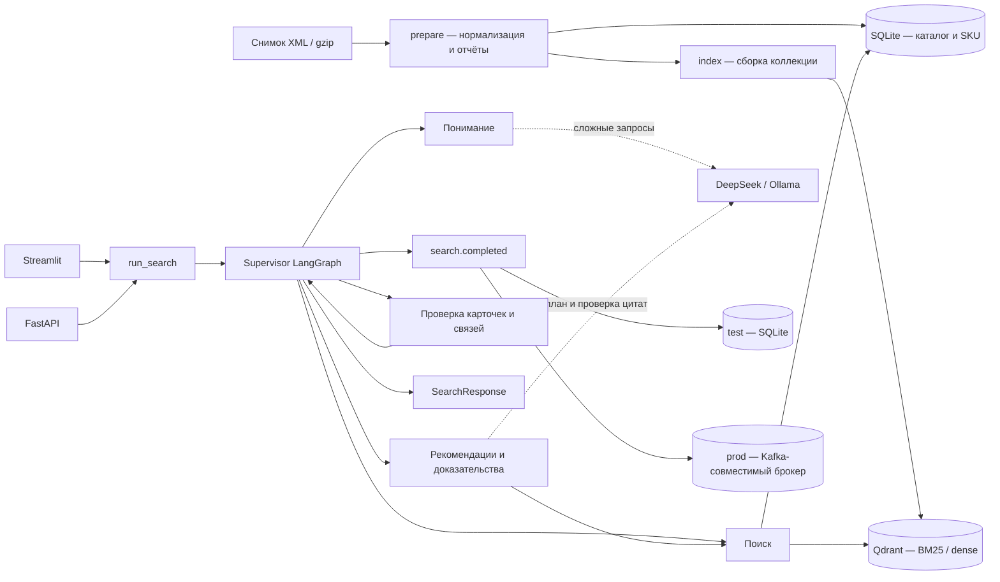
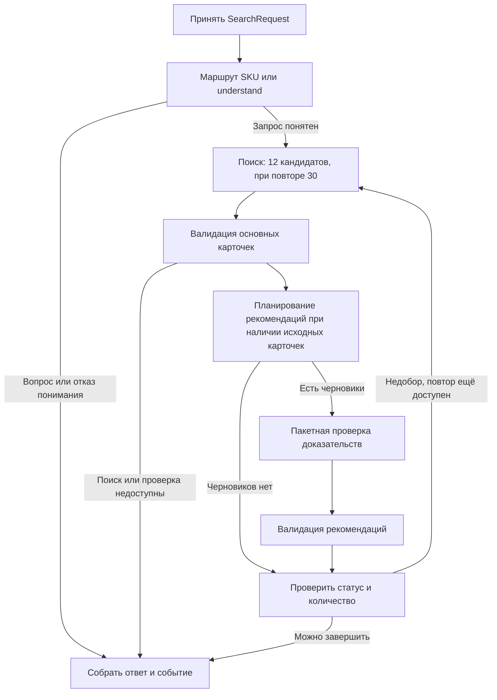

# Умный поиск Softline — технический отчёт по проекту

Отчёт описывает интеграционную сборку `f227524871d50403e1ef7c26d4978c00645da96b` в ветке `dev` и локальной копии `kuznica_merge`. Сборка объединяет четыре модуля. Основной сценарий принимает свободный поисковый запрос, ищет предложения в снимке каталога Softline, проверяет условия покупки и может показать альтернативы или дополнения с источниками. После обработки он формирует событие аналитики. [Ветка dev](https://github.com/Crocodilchik/kuznica_smart_search/tree/dev) · [README сборки](README.md)

## Содержание

1. [Задача и результаты](#1-задача-и-результаты)
2. [Архитектура и состав модулей](#2-архитектура-и-состав-модулей)
3. [Подготовка каталога и индекса](#3-подготовка-каталога-и-индекса)
4. [Путь запроса и оркестрация](#4-путь-запроса-и-оркестрация)
5. [Понимание запроса, валидация и модели](#5-понимание-запроса-валидация-и-модели)
6. [Рекомендации и доказательства](#6-рекомендации-и-доказательства)
7. [Интерфейсы и контракты](#7-интерфейсы-и-контракты)
8. [Аналитика и доставка событий](#8-аналитика-и-доставка-событий)
9. [Сценарии проверки](#9-сценарии-проверки)
10. [Тестирование, измерения и CI](#10-тестирование-измерения-и-ci)
11. [Запуск и диагностика](#11-запуск-и-диагностика)
12. [Ограничения и дальнейшая работа](#12-ограничения-и-дальнейшая-работа)
13. [Порядок изучения исходников](#13-порядок-изучения-исходников)

## 1. Задача и результаты

Исходная таблица заказчика `Выборка поисковых запросов.xlsx` и рабочие материалы `grand_plan.md`, `materials.md` и `add_research.md` хранятся в локальной рабочей директории рядом с клоном. В репозитории доступны бриф и ранняя версия архитектурного плана. [Бриф Softline](<module2/lit/ИИкузница_—_Умный поиск на сайте.pdf>) · [Ранняя версия плана](module2/grand_plan.md)

Кейс «ИИкузница» посвящён поиску IT-продуктов на Store.softline.ru. Покупатель может описать задачу разговорным языком, указать артикул или назвать ограничения — например, бюджет, платформу и количество устройств. Система должна различать поиск самого товара, поиск замены и подбор дополнений. Для подборочного запроса ориентир составляет четыре подходящих предложения, если они есть в данных и проходят проверку. При запросе по точному SKU достаточно одной карточки. Для утверждения о совместимости нужен источник, относящийся к той же паре товаров. [Бриф Softline](<module2/lit/ИИкузница_—_Умный поиск на сайте.pdf>) · [Распределение ролей и контрактов](project-agent-roles.md)

В исходных материалах около 200 тыс. позиций и 500 запросов в день фигурируют как оценки масштаба магазина. Локальная сборка использует конкретный XML-снимок на **136 040 предложений** из **9 311 категорий**. В него входит историческое наличие. Выборка заказчика в Excel служит материалом для проверок пользовательских формулировок, в том числе поиска по названию или вендору и проверки целевого URL. Скрипт оценки использует самостоятельный формат JSON с оценками релевантности по ID предложений. [EDA каталога](reports/eda.md) · [Демонстрационная разметка](tests/fixtures/demo_judgments.json)

Функциональная проверка на полном индексе подтвердила точный поиск по SKU, ограничение по бюджету, выдачу вариантов одного семейства и явную диагностику неизвестной страны. Отдельные сквозные тесты подтвердили прохождение рекомендации с доказательством и публикацию события через Kafka-протокол. Готовый локальный индекс содержит BM25. Подключение семантической модели, действующего LLM-аккаунта и брокера стенда описано отдельно. [Сценарии проверки](#9-сценарии-проверки) · [Запуск и диагностика](#11-запуск-и-диагностика)

## 2. Архитектура и состав модулей

Проект — Python-приложение с общим поисковым контуром для двух входов. Streamlit предназначен для ручного поиска и показа прототипа, FastAPI — для программного вызова. Оба работают через `smart_search.runtime`. LangGraph управляет маршрутом запроса, а подключаемый backend предоставляет функции понимания, поиска, рекомендаций, проверки источников и валидации. Подготовка каталога и оценка запускаются отдельными командами. [Точка сборки backend](smart_search/backend.py) · [Выбор режима](smart_search/runtime.py)



| Исходная ветка | Что вошло в сборку | Где читать |
| --- | --- | --- |
| `module1` · `89cc704` | Supervisor, общие модели, два режима, Streamlit, HTTP API, журнал и Kafka-продьюсер, скрипт оценки | [smart_search](smart_search) · [Supervisor](smart_search/supervisor.py) |
| `module2` · `eb51162` | Общий асинхронный LLM-клиент, фабрика DeepSeek/Ollama/mock. При интеграции добавлены `understand`, `validate` и синхронный вызов клиента из графа | [LLM-клиент](smart_search/llm) · [Понимание](smart_search/understanding.py) · [Валидация](smart_search/validation.py) |
| `module-3` · `5e4f31a` | XML-парсер, нормализованный каталог, справочники, SQLite, Qdrant, точный, лексический, dense и hybrid режимы | [softline_search](softline_search) · [Адаптер каталога](smart_search/catalog_backend.py) |
| `module4` · `2281986` | Планирование поиска рекомендаций, граф категорий, пакетная проверка доказательств | [Рекомендации](src/recommendation.py) · [Проверка источников](src/research.py) · [Интеграционный адаптер](smart_search/recommendation_backend.py) |

Общие модели написаны на Pydantic. Работа с HTTP идёт через FastAPI, Uvicorn и HTTPX. XML разбирается через `defusedxml`. Для русской лексики используется Snowball-стеммер. Опциональные эмбеддинги предоставляет FastEmbed, для доставки событий используется `confluent-kafka`. Зависимости объединённой сборки закреплены в `uv.lock`, минимальная версия Python — 3.12. [Зависимости](pyproject.toml) · [Lock-файл](uv.lock)

В `src/` сохранены автономный экспериментальный tool loop и собственные компоненты каталога и векторного поиска модуля 4. Встроенный backend использует общий клиент модели из модуля 2 и общий `SearchEngine` модуля 3, в том числе для поиска кандидатов в рекомендации. Отдельные база и NPZ-индекс модуля 4 нужны для его автономной команды. Каталог `handoff/` хранит снимок ранее переданных контрактов и примеров. [Автономный агент](src/agent.py) · [Руководство модуля 4](MODULE4.md) · [Материалы передачи каталога](docs/TEAM_HANDOFF.md)

## 3. Подготовка каталога и индекса

### 3.1 Импорт и нормализация

1. `python -m softline_search prepare` открывает XML или gzip. Сжатие распознаётся по содержимому. Парсер потоково читает категории и предложения и освобождает обработанные элементы дерева. Внешние XML-сущности не разрешаются.
2. `normalize_offer` формирует покупаемую позицию `Product`. Ключ `product_id` соответствует ID предложения из фида, `sku` берётся из `vendorCode`, идентификатор семейства — из исходной группировки, когда она доступна. Карточка содержит категорию, путь и предков категории, бренд, URL, цену, доступность, данные лицензии, описание и дату источника. Разные предложения одного семейства сохраняют отдельные ID и условия покупки.
3. Цена хранится целым числом копеек. Например, `30_000_000` копеек — 300 000 ₽. Нулевая цена из выгрузки, неизвестная цена или валюта без поддерживаемого рублёвого значения дают `null`. Пустой `vendorCode` остаётся отсутствующим SKU. По `product_id` доступен отдельный внутренний lookup.
4. Повторяющиеся `param` превращаются в списки. Полезные пары из структурированной части описания сохраняются в `attributes.description_fields`. ОС извлекается из сведений о платформе. Страна фиксируется по явному полю происхождения или производства. Вместимость лицензии и единица измерения извлекаются из однозначных значений. Количество пользователей и устройств учитываются как разные единицы.
5. Контур записывает `catalog.sqlite`, `products.jsonl`, срез `sample_products.jsonl`, справочники `categories.json`, `category_aliases.json`, `attributes.json` и `manifest.json`. В отдельный каталог отчётов попадают профиль полей и журнал отклонённых предложений. Дубликат ID диагностируется без замены предыдущей позиции. [Парсер](softline_search/feed.py) · [Сборка каталога](softline_search/catalog.py) · [Инструкция каталога](README-catalog.md)

Снимок датирован **25.11.2026 14:12** по данным фида. Приняты все 136 040 предложений, из них 44 601 были отмечены как доступные. В репрезентативном срезе 300 позиций. Покрытие нормализованных атрибутов объясняет результаты строгих фильтров.

| Атрибут | Известен у предложений | Что это означает для поиска |
| --- | ---: | --- |
| SKU | 44 978 / 33,1% | Точный поиск доступен для предложений с указанным артикулом |
| Цена в копейках | 55 771 / 41,0% | При ограничении бюджета нужна подтверждённая цена |
| Ёмкость лицензии | 20 980 / 15,4% | Для запроса на N устройств также нужна единица `device` |
| Страна | 0 / 0,0% | Строгий запрос на страну даёт диагностируемый недобор |
| ОС | 49 013 / 36,0% | При обязательной платформе неизвестное значение исключает карточку |
| Минимальная покупка | 98 723 / 72,6% | Известный минимум влияет на полную стоимость |

Данные о покрытии и наличии взяты из [EDA разработчика 3](reports/eda.md) и манифеста локального каталога `data/catalog/manifest.json`. Полнота по полям характеризует этот снимок и текущие правила извлечения.

### 3.2 Режимы поиска

| Режим | Реализация | Что важно при интерпретации |
| --- | --- | --- |
| `sku` | Индекс SQLite по нормализованному артикулу | Сопоставляет SKU без учёта регистра и сохраняет значимые символы артикула. Может работать при недоступном Qdrant |
| `bm25` | Полнотекстовый scoring Qdrant или sparse-вариант Qdrant/BM25 | Лексический запрос и документы используют одинаковую нормализацию. Заголовок получает дополнительный вес через формирование текста |
| `dense` | Сходство векторов запроса и документа | Для поиска и индексации нужна одна и та же модель, включая размерность. Недоступный dense-канал возвращает диагностику |
| `hybrid` | Независимые BM25 и dense с объединением RRF | Вклад результата из каждого канала равен `1 / (60 + rank)`. При недоступности одного канала возможна выдача от второго с предупреждением |

Дерево категорий допускает поиск по ID, имени, полному пути или известному псевдониму, например `endpoint_security`. Для поддерева учитываются предки категории. Если категория явно передана и не разрешилась, поиск возвращает `category_unresolved`. Каналы применяют обязательные ограничения и повторно проверяют карточку, когда фильтра на payload недостаточно, например при расчёте минимальной покупки. Если набор лицензий можно суммировать, разрешение должно быть явным, а итоговая стоимость проверяется по количеству покупаемых единиц. [Поиск и фильтры](softline_search/search.py) · [Расчёт лицензий](softline_search/licensing.py)

### 3.3 Публикация индекса

Команда `index` создаёт отдельную коллекцию и загружает данные батчами. Активный манифест `index.json` публикуется после успешной загрузки. В нём хранятся имя коллекции, число карточек, механизм BM25, хеши XML и нормализованного каталога, полнота и параметры dense-модели. Перед чтением код сверяет манифест с каталогом и режимом подключения. В локальной сборке коллекция содержит все 136 040 предложений, `backend=fulltext`, `is_subset=false` и `dense_model=null`. Полная локальная индексация заняла около **83 секунд** в одном зафиксированном прогоне. При замене каталога и индекса перезапускают процесс приложения, чтобы загрузить совместимые снимки. [Построение коллекции](softline_search/retrieval.py) · [Проверка готовности](smart_search/catalog_backend.py)

## 4. Путь запроса и оркестрация

### 4.1 Состояние графа

`build_search(Services)` компилирует LangGraph и возвращает синхронный обработчик `SearchRequest → SearchResponse`. В состоянии одного вызова хранятся исходный запрос, `QuerySpec`, поисковые результаты, исходные карточки для рекомендаций, черновики рекомендаций, доказательства, результат проверки, предупреждения, счётчик повторов и список шагов. Runtime переиспользует собранный обработчик. Долгоживущий экземпляр адаптера каталога переиспользует индекс и синхронизирует доступ к локальному Qdrant. [Код графа](smart_search/supervisor.py) · [Рабочий адаптер каталога](smart_search/catalog_backend.py)



### 4.2 Решения по маршруту

| Этап | Что происходит | Наблюдаемое поле |
| --- | --- | --- |
| Разбор | Отдельная форма `Артикул: …` или `SKU: …` сразу получает точный маршрут. Другие запросы проходят `understand`. Если есть уточняющий вопрос, граф завершает поиск до обращения к индексу | `steps`, `intent`, `clarifying_question` |
| Поиск | Для распознанного SKU вызывается `sku`. Для остальных берётся настроенный канал. Начальный лимит кандидатов — 12 | `search:sku`, `search:bm25`, `search:hybrid` или `search:dense` |
| Исходный товар для связи | В запросах о замене и дополнении при первом поиске покупательские фильтры временно снимаются, чтобы найти сам исходный товар. Например, цена исходной позиции может превышать бюджет на замену. Модулю рекомендаций передаётся первый кандидат. Финальный валидатор снова получает все исходные ограничения и проверяет пригодность ссылки на исходную позицию | `anchor_id`, причины проверки |
| Первичная проверка | `validate` вызывается с пустым списком рекомендаций и источников. При обычном подборе в рекомендации могут передаваться до трёх прошедших проверку карточек. Для точной покупки по SKU ветка рекомендаций пропускается | `validate:products` |
| Связи | При наличии черновиков `research_batch` получает те же снимки исходных карточек и до восьми рекомендаций. Затем `validate` повторно проверяет основной блок и принимает только допустимые связи | `recommend`, `research`, `validate:recommendations` |
| Повтор | При недоборе возможен один повтор с лимитом 30. Поисковая формулировка и жёсткие условия остаются прежними. Первые и дополнительные кандидаты объединяются по `product_id` с сохранением первого вхождения | `retry_count`, `retry` |
| Завершение | Supervisor собирает проверенные карточки, статусы, причины и предупреждения. Затем создаёт событие аналитики | `SearchResponse`, `search.completed` |

При общем поиске порог считается по уникальным основным предложениям. Для `alternatives` он считается по принятым заменам, для `complements` — по принятым дополнениям. Поэтому при запросе на дополнение исходная карточка может присутствовать в ответе со статусом `empty`, если подходящие дополнения не подтверждены. Для точного запроса с SKU порог равен одному, для остальных — четырём. Дедупликация по `product_id` сохраняет предложения одного семейства как разные карточки. [Условия завершения в Supervisor](smart_search/supervisor.py)

Агентные решения сосредоточены в трёх местах: структурированная интерпретация сложного запроса, планирование до двух направлений поиска рекомендаций и пакетная проверка утверждений. Python управляет очередностью, лимитами, исполнением запросов к каталогу и финальным ответом. `src/agent.py` содержит отдельный эксперимент с многошаговым tool loop. Пути публичных интерфейсов используют граф из `smart_search/supervisor.py`. [Интеграционный backend](smart_search/backend.py) · [Экспериментальный агент](src/agent.py)

## 5. Понимание запроса, валидация и модели

### 5.1 Query Understanding

`understand(SearchRequest)` сначала применяет правила. Они нормализуют известный жаргон и опечатки, например «антивирь» и «винда», различают явный артикул и версию продукта, ищут бюджет, количество устройств, ОС, наличие, происхождение и признаки покупки комплекта. Суммы переводятся в копейки через `Decimal`. Верхний предел входит в `hard_filters`, пожелание «примерно за …» — в `preferences.target_price_kopecks`. При простом запросе этих правил достаточно. При поиске замены или дополнения формулировка для поиска описывает исходный товар.

Для сложного запроса модуль просит модель вернуть JSON по схеме `QuerySpec`. Код сохраняет исходную строку и значения обязательных фильтров, которые уже извлёк сам. Предложенную моделью категорию проверяет по справочнику, кроме заранее определённых технических псевдонимов. Версия из разобранного текста сохраняется. При тайм-ауте, ошибке провайдера или невалидном JSON используются результаты правил и предупреждение `understanding_llm_fallback`. Если правила видят существенную неоднозначность, например запрос замены Windows Server без указания нужной роли, граф задаёт вопрос. Streamlit может передать первоначальный текст вместе с последующим ответом. [Понимание запроса](smart_search/understanding.py) · [Форма и контекст](smart_search/interfaces/web.py)

Пример нормализованных полей для запроса «Российский антивирь для винды на 50 компов до 100к»:

```json
{
  "intent": "product_search",
  "category": "endpoint_security",
  "hard_filters": {
    "os": "Windows",
    "country": "RU",
    "devices": 50,
    "max_total_price_kopecks": 10000000,
    "budget_scope": "primary",
    "in_stock": null
  }
}
```

По полному каталогу этот запрос возвращает `country_unknown_in_catalog`. По имени вендора или языку интерфейса система страну не выводит. [Правила полного поиска](softline_search/search.py)

### 5.2 Общий клиент модели

`LLMFactory` выбирает DeepSeek, Ollama или mock. Асинхронный контракт предоставляет `generate`, `complete_json` и `aclose`. Структурированный ответ проверяется Pydantic. Адаптеры преобразуют ошибки HTTP, тайм-ауты, недоступность и ошибки формы ответа в общие исключения. DeepSeek использует JSON-режим. Использование Ollama требует работающего сервера с указанной моделью. `smart_search/model_client.py` запускает асинхронный вызов на синхронной границе и закрывает ресурсы клиента после вызова.

Автоматической смены провайдера при сбое нет. Решение продолжить по правилам или графу категорий принимает вызывающий модуль по назначению запроса. Модель для разбора и рекомендаций задаётся через `LLM_PROVIDER`. Модель для эмбеддингов выбирается отдельно через `SOFTLINE_DENSE_MODEL`. [Фабрика](smart_search/llm/factory.py) · [Общий клиент](smart_search/llm/client.py) · [Синхронная граница](smart_search/model_client.py)

### 5.3 Validation

Валидатор выполняется обычным кодом. Для прямых карточек он сверяет артикул, категорию и доступные признаки запрошенной версии. Для серверного оборудования дополнительно исключает карточки с явным признаком ПО или рабочей станции. Проверяет обязательную ОС, страну, наличие, тип и вместимость лицензии. Одно неизвестное обязательное поле может исключить позицию даже при высоком поисковом балле. Пожелания хранятся отдельно. Ранжирование по мягким предпочтениям бренда и целевой цены в общем поиске пока отсутствует.

Для покупки рассчитывается количество продажных единиц. Например, для 41 устройства при вместимости 10 нужны пять лицензий и явное подтверждение возможности суммирования. При цене 15 000 ₽ за единицу итог составляет 75 000 ₽. Минимальное количество к покупке также входит в расчёт. Для замены действует бюджет на покупку самой альтернативы. При общем бюджете комплекта проверяется накопленная стоимость исходной позиции и принятых дополнений к ней. При бюджете только на основной товар его предел не переносится на дополнения.

В рекомендациях валидатор сопоставляет тройку `anchor_id`, `product_id`, `claim`. Для принятия нужен результат `confirmed` с источником, который содержит поле каталога или пригодный URL документа. Наличие противоречия в доказательствах исключает рекомендацию. У каждой причины есть отдельный код, например `sku_mismatch`, `version_unconfirmed`, `os_unconfirmed`, `license_capacity_insufficient`, `price_unknown`, `budget_exceeded`, `evidence_unconfirmed`. [Реализация валидатора](smart_search/validation.py) · [Проверки бизнес-правил](tests/unit/test_integrated_validation.py)

## 6. Рекомендации и доказательства

1. **Выбор направлений.** В режиме `llm` модуль получает описание запроса, до трёх исходных карточек и справочник поисковых категорий. Модель возвращает до двух направлений. У направления есть ID исходного предложения, ID категории, поисковая формулировка и фрагменты названия для отсечения неподходящего типа. Код проверяет эти параметры и запускает обычный поиск по каталогу. Модель не создаёт цены, карточки и ссылки.
2. **Локальный резерв.** При отказе модели используется граф категорий из JSON. В исходном графе есть маршруты от ноутбуков к мышам и сумкам и от ИБП к сменным батареям. Для альтернатив доступен подбор вариантов с совпадающими идентификатором, названием семейства и категорией. Близость по категории служит условием отбора, а вывод о варианте формулируется как принадлежность одному семейству.
3. **Проверка источников.** Для дополнения сначала ищется явное совпадение модели или SKU в полях совместимости или несовместимости. Для вариантов того же семейства в доказательство входят соответствующие поля обеих карточек. При отсутствии явного факта в режиме модели оставшиеся пары передаются одним пакетом. Модель возвращает статус и цитаты с указанием карточки и поля. Код проверяет, что фрагменты буквально присутствуют в переданных карточках и охватывают оба товара. Чужой ID, неподходящее поле или вымышленная цитата ведут к отсутствию подтверждения.
4. **Показ результата.** `confirmed` с подходящим источником может попасть в выдачу после проверки ограничений. `unknown` или `contradicted` исключается. Для отображения доступны тип связи, карточка, утверждение, цитата, поле и URL источника при его наличии. Связь с конкретным исходным товаром сохраняет `anchor_id`.

Буквальное совпадение цитаты подтверждает происхождение фрагмента. Вывод о техническом смысле этих двух фрагментов при LLM-проверке всё ещё зависит от модели. Для инженерно точной совместимости по версиям полезны проверяемые таблицы вендора или формализованные правила. В рабочем контуре этой сборки доказательства берутся из каталога. Официальный корпус поставщиков из проектного плана отсутствует. [Планировщик](src/recommendation.py) · [Граф категорий](data/recommendation_graph.json) · [Проверка цитат](src/research.py) · [Адаптер рекомендаций](smart_search/recommendation_backend.py)

## 7. Интерфейсы и контракты

### 7.1 Пользовательский и программный входы

| Вход | Как работает |
| --- | --- |
| Streamlit в `test` | Принимает ввод с клавиатуры и предлагает готовые примеры из `ui_config.json`. Вкладка проверки прогоняет список и показывает исходы. Ручные запросы попадают в журнал для вкладки аналитики. Массовый прогон работает без записи событий |
| Streamlit в `prod` | Принимает произвольный текст и отображает карточки, цены, статус и доказательства. Если задан `SMART_SEARCH_API_URL`, вызывает FastAPI, чтобы один процесс владел локальным индексом. С пустым адресом вызывает общий обработчик внутри процесса Streamlit |
| `POST /v1/search` | JSON-вход для рабочего контура. Достаточно поля `query`. Граничная проверка — от 1 до 1000 символов после обрезки пробелов. Можно передать `request_id`, `session_id` и `previous_context` |
| `GET /health/ready` | Проверяет режим, доступность backend и его обязательные экспорты. Встроенная проверка читает SQLite и манифест индекса и сверяет коллекцию. При локальном индексе читаются файлы без запуска поиска. Для удалённого Qdrant проверяется существование коллекции |
| Python | `run_search(SearchRequest(query="Сервер"))` использует выбранный режим. `build_search(services)` позволяет подставлять функции и получателя событий при тестировании |

`POST /v1/search` принимает только известные поля. Ограничения задаются текстом запроса. При отсутствии `request_id` создаётся UUID. Один и тот же идентификатор связывает результат и событие. Повтор запроса с этим идентификатором выполняет поиск снова. Интерактивная документация доступна по `/docs`, схема — по `/openapi.json`. [HTTP-контракт](docs/contracts/contract_request_interface.md) · [Форма](smart_search/interfaces/web.py) · [Настройки интерфейса](smart_search/interfaces/ui_config.json)

| Статус ответа | HTTP | Когда возникает |
| --- | ---: | --- |
| `ok` | 200 | Порог подходящих карточек достигнут |
| `partial` | 200 | Доступны проверенные карточки, их число меньше порога |
| `empty` | 200 | Поиск обработан, подходящих карточек в целевом блоке нет |
| `clarification_needed` | 200 | Возвращён вопрос для устранения неоднозначности |
| `unavailable` | 503 | Отказ обязательного этапа или недоступность ветки явно запрошенных рекомендаций при отсутствии подтверждённого результата |
| Ошибка конфигурации | 503 | JSON с `code` и `message`, например `backend_not_configured` или `catalog_unavailable` на проверке готовности |
| Ошибка входных данных | 422 | JSON с деталями валидации FastAPI |

Ответ также содержит `products`, `recommendations`, `intent`, `clarifying_question`, `warnings`, `reason_codes`, `retry_count` и `steps`. Среди полей карточки сохраняются ID, название, категория, версия снимка, исходные атрибуты и URL при наличии. [Модели ответа](smart_search/contracts.py) · [HTTP-обработчики](smart_search/interfaces/api.py)

### 7.2 Связь модулей

| Функция `Services` | Вход → результат |
| --- | --- |
| `understand` | `SearchRequest → QuerySpec` с намерением, нормализованным текстом, фильтрами, пожеланиями и вопросом при необходимости |
| `search` | `SearchParams → SearchResult` со списком ранжированных `SearchHit`, флагом доступности и диагностикой |
| `recommend` | `QuerySpec + list[Product] → RecommendationResult` с черновиками по исходным карточкам |
| `research` | `RecommendationDraft → EvidenceResult`, обязательный одиночный контракт. Во встроенном backend без снимка исходной карточки даёт `unknown` |
| `validate` | `QuerySpec + SearchResult + RecommendationResult + list[EvidenceResult] → ValidationResult` с допущенными позициями и причинами исключения |
| `research_batch`, опционально | `QuerySpec + list[Product] + list[RecommendationDraft] → list[EvidenceResult]`. Рабочий способ проверки пары в интегрированном контуре |
| `check_ready`, опционально | Проверяет доступность данных для поиска. При сбое встроенный backend поднимает `ConnectionError` |

Поисковый адаптер преобразует общие модели в модели каталога и обратно. Поля происхождения и вложенные атрибуты сохраняются. Нативный статус каталога `unavailable` отображается через `available=False`, пустое совпадение остаётся успешным вызовом с пустыми `hits`. Ранжирование, статусы поиска и бизнес-решения о составе ответа принадлежат разным этапам. При доработке модуля нужно сохранить различие между пустым результатом и отказом зависимости, сумму в копейках, значения `null` и стабильные ID. [Тип Services](smart_search/tools.py) · [Контракт инструментов](docs/contracts/contract_tools_interface.md) · [Правила для разработчиков](AGENTS.md)

## 8. Аналитика и доставка событий

Supervisor создаёт `SearchEvent` после формирования ответа для каждого завершённого вызова графа. Это включает `empty`, `clarification_needed` и `unavailable`. Отклонённый на входе HTTP-запрос с `422` до графа не доходит. `latency_ms` измеряется от начала графа до подготовки события. Ожидание подтверждения брокера добавляет время HTTP-запросу и находится за границей этой метрики.

В `test` хранилище `EventStore` использует `.local/events.sqlite3` или путь из `SMART_SEARCH_EVENT_DB`. Ключ таблицы — `request_id`, при повторе сохраняется первая запись. Вкладка аналитики показывает число поисков, статусы, долю пустых выдач, проблемные категории, причины и p95. Проблемными считаются категории с `empty` и `partial`. Доля пустых выдач считается по знаменателю `ok + partial + empty`. p95 берётся по ближайшему рангу отсортированных значений.

В `prod` приложение отправляет JSON в Kafka-совместимый топик `smart-search.search-events.v1`. Kafka-ключ — UTF-8 `request_id`, `event_id` — `search.completed:<request_id>`. Пример сокращённого сообщения:

```json
{
  "event_id": "search.completed:store-42",
  "event_type": "search.completed",
  "schema_version": 1,
  "payload": {
    "request_id": "store-42",
    "normalized_query": "Сервер",
    "intent": "product_search",
    "status": "partial",
    "result_count": 1,
    "recommendation_count": 0,
    "latency_ms": 420,
    "retry_count": 1,
    "reason_codes": ["not_enough_products"],
    "category": "server_hardware",
    "occurred_at": "2026-11-27T12:00:00Z"
  }
}
```

Продьюсер использует `acks=all` и `enable.idempotence=True`. По умолчанию ожидает отчёт о доставке до 1000 мс. При сбое журналирует ошибку, а поисковый ответ сохраняется. Сетевые повторы внутри Kafka и повтор пользовательского HTTP-запроса — разные случаи. Два HTTP-вызова с одинаковым ID могут породить два сообщения, поэтому при подсчёте логических поисков потребитель дедуплицирует `event_id`. При отказе возможна потеря события, так как устойчивой очереди для последующей отправки нет. Рабочий режим содержит продьюсер и контракт. Потребитель аналитики, сбор кликов и показов, агрегация конверсии в этом репозитории не реализованы. Данные события включают нормализованный текст, счётчики, категорию и время. Идентификатор сессии и предыдущий диалог исключены из payload. [Контракт событий](docs/contracts/contract_events_interface.md) · [Продьюсер](smart_search/events/kafka.py) · [SQLite и агрегаты](smart_search/analytics.py)

## 9. Сценарии проверки

### 9.1 Полный каталог и рабочие адаптеры

В зафиксированном прогоне интеграционной сборки запросы отправлялись через FastAPI TestClient в режиме `prod` с реальным локальным каталогом и индексом BM25. Для модели был выбран офлайн-режим `mock`, для рекомендаций — `graph`. К поисковому сервису поступали обычные HTTP-запросы через его ASGI-обработчик. `GET /health/ready` вернул `200`.

| Запрос | Что прошёл запрос | Фактический исход |
| --- | --- | --- |
| `Артикул: AL16-03SWS701-0100` | Точный маршрут SQLite, валидация артикула, сборка ответа | `ok`, предложение `324046`, один основной товар |
| `Сервер до 300 тысяч` | Бюджет 30 000 000 копеек, категория оборудования, BM25 и валидация, один повтор при недоборе | `partial`, микросервер DEPO Stream `531625`. Это единственное предложение в проверенных категориях и бюджете. Холодный вызов — около 36,6 с |
| `Аналоги AL16-03SWS701-0100` | SKU определил исходную карточку, затем поиск вариантов и доказательства по полям семейства | `ok`, варианты `324058`, `324060`, `324059` и `324047`. У каждой связи два источника из карточек. Вызов — около 6,3 с |
| `Что докупить к AL16-03SWS701-0100?` | Точный исходный товар, попытка поиска дополнений по локальному графу | `empty` в целевом блоке с `recommendation_graph_no_rule`. В ответе есть исходная карточка `324046` |
| `Российский антивирь для винды на 50 компов до 100к` | Извлечение страны, ОС, числа устройств и бюджета, проверка покрытия по стране | `empty`, `country_unknown_in_catalog`. Этот исход характеризует снимок и правила извлечения |

Это функциональные наблюдения одного прогона. Время холодного запроса включает загрузку индекса. Для p95 нужна серия повторяемых измерений в одинаковых условиях. [Как подготовлен индекс](README-catalog.md) · [Команды воспроизведения](#11-запуск-и-диагностика)

### 9.2 Проверка доказательств, отказа и интерфейсов

- **Подтверждённое дополнение.** На небольшом каталоге, построенном тестом из XML, `Что докупить к UPS-A10?` сначала находит ИБП. Батарея с артикулом ИБП в поле совместимости проходит проверку. Система возвращает `partial` с одной рекомендацией, сохраняет поле источника и формирует ровно одно событие за итоговый запрос, включая повтор.
- **Ошибочный ответ модели.** В том же контуре тестовый DeepSeek через HTTPX возвращает план, а затем вымышленную цитату для другой батареи. Связь с вымышленным фрагментом не попадает в выдачу. Дополнение с явным каталожным подтверждением сохраняется.
- **Провайдер без ключа.** Тест фабрики моделирует отказ конфигурации. Поиск переходит к графу, сохраняет подтверждённую связку и передаёт предупреждения. Это независимый тест без внешнего API.
- **Запрос уточнения.** Для замены Windows Server без роли пользователь получает вопрос о назначении. До ответа поисковый этап не исполняется. При повторном вводе форма может передать исходный текст в `previous_context`.
- **Отказ индекса или брокера.** Недоступность общего индекса сигнализируется как технический отказ. SKU может работать на SQLite. Сбой Kafka относится только к доставке события. Тест с временным Kafka-совместимым брокером проверяет чтение сообщения отдельным потребителем.
- **Демо.** В режиме `test` уместен сценарий «Что докупить к Astra Linux SE?» с фикстурой рекомендации КриптоПро CSP. Сценарий проверяет отображение карточки, подписи и аналитику в Streamlit. Источник и связь в этом примере заданы демонстрационным набором.

[Сквозной тест пайплайна](tests/integration/test_pipeline.py) · [Тесты Supervisor](tests/unit/test_supervisor.py) · [Тесты Streamlit](tests/integration/test_app.py) · [Доставка Kafka](tests/integration/test_kafka_delivery.py)

## 10. Тестирование, измерения и CI

### 10.1 Автоматические проверки

На локальной копии интеграционного коммита повторно выполнены `python -m pytest -q`, `ruff check .` и `ruff format --check .`. **117 тестов прошли за 9,24 с**, Ruff подтвердил отсутствие замечаний и форматирование 93 файлов. Тесты пользуются временными каталогами и транспортами. Для проверки общих контрактов достаточно локальных зависимостей и loopback, внешний DeepSeek и рабочий брокер не нужны.

| Набор | Число кейсов | Что покрывает |
| --- | ---: | --- |
| `tests/catalog` | 40 | Нормализацию XML/gzip, цену и лицензию, обработку дублей, устойчивость к внешним сущностям, открытие сохранённого индекса, штатный и запасной BM25, RRF, строгие условия и проверку хешей |
| `tests/llm` | 18 | Выбор провайдера и параметров, настройки из окружения, корректный JSON, невалидную схему, ответы HTTP и тайм-ауты. Сетевой транспорт подменён |
| `tests/unit` | 38 | Маршруты LangGraph, сохранение фильтров и один повтор, правила разбора и проверки, бюджет комплектов, сводку SQLite, метрики и гарантию ограниченного ожидания брокера |
| `tests/integration` | 21 | FastAPI, Streamlit, основной backend на временном индексе, SKU без Qdrant, расхождение каталога с индексом, dense с тестовым векторизатором, LLM-ответы, продьюсер и потребитель на временном Kafka-совместимом брокере |
| **Итого** | **117** | Количество включает параметризованные кейсы pytest |

Отдельный каталог для проверки доказательств создаётся внутри теста. Dense и hybrid проверяются с контролируемым векторизатором, который позволяет предсказать ранжирование. Это проверка корректности подключения и фильтров. Реальная семантическая релевантность модели FastEmbed требует полноразмерной индексации и отдельной оценки. [Исходники тестов](tests) · [Конфигурация pytest](pyproject.toml)

### 10.2 Как оценивать поиск

В материалах проекта есть два источника запросов:

- **Выборка заказчика** содержит 10 пар «запрос → целевой URL». Например, `anydesk` ведёт на страницу семейства AnyDesk, `мтс` — на витрину, `кибер бэкап` — на страницу вендора с фильтром категории. Страницы семейств, витрины и отдельные предложения надо оценивать с учётом ожидаемого типа цели. Эту таблицу можно использовать для ручного прогона и последующей разметки кандидатов.
- **Встроенный демонстрационный набор** содержит 8 запросов с оценками `grades` от 0 до 3 по стабильным ID. Например, запись вида `{"query":"Сервер","grades":{"495105":3}}` сопоставляет карточку и степень релевантности. Скрипт `scripts.evaluate` принимает такой JSON и сохраняет отчёт с результатами по каждому запросу и агрегатами.

Скрипт запускает `bm25`, `dense`, `hybrid` и `agentic_hybrid`. Базовые режимы передают текст напрямую в поиск и валидатор. Агентский режим создаёт полный граф и включает понимание запроса, маршруты и повтор. Оценка ранжирования использует список `products`. Для качества дополнений и альтернатив нужны отдельные метрики по блоку `recommendations` и источникам.

| Метрика | Расчёт и область применения |
| --- | --- |
| Precision@4 | Число уникальных карточек с оценкой выше нуля в первых четырёх, делённое на четыре. Незанятые позиции уменьшают показатель |
| NDCG@10 | DCG первых десяти с привесом `2^grade - 1` и логарифмическим дисконтом, делённый на идеальный DCG. Для нулевого идеального DCG скрипт возвращает 0 |
| Доля пустых выдач | Доля `empty` среди `ok + partial + empty`. Сбои и уточнения видны в разбивке статусов |
| p95 | Не менее 95% записанных длительностей укладываются в это значение. Холодные и прогретые запросы полезно замерять отдельно |
| Прямые и навигационные сценарии | Для артикула можно считать долю точных первых попаданий. Для витрин и страниц семейств нужен отдельный показатель совпадения целевого URL |
| Условия и доказательства | Для приёмки подходят доля нарушений обязательных условий, точность подтверждённых рекомендаций при ручной проверке, покрытие доказательствами и доля неопределённых связей |

Исторический демонстрационный отчёт на восьми запросах даёт Precision@4 около **0,156**, NDCG@10 около **0,326** и долю пустых выдач **50%** у трёх базовых режимов. Для полного графа с той же фикстурой это около **0,344**, **0,88** и **12,5%**. Базовые режимы в демо используют один и тот же адаптер. Эти значения показывают работу вычисления и влияние маршрутов на демонстрационные примеры. Сравнение поисковых моделей требует рабочего индекса с обоими каналами и отдельной размеченной выборки. Для обоснованного сравнения нужно размечать объединение кандидатов разных методов. Иначе карточка без оценки получит ноль, даже если она полезна. Для доказательства коммерческого эффекта нужны пользовательские события и эксперимент на реальном трафике. [Формулы и режимы](scripts/evaluate.py) · [Демонстрационная разметка](tests/fixtures/demo_judgments.json)

### 10.3 Непрерывная проверка

GitHub Actions запускается для `pull_request` и вручную через `workflow_dispatch`. На Ubuntu с Python 3.12 выполняются установка из `uv.lock`, Ruff, pytest и демонстрационный прогон оценки. Workflow проверяет код и фикстуры. Стадии развёртывания инфраструктуры и автоматического выпуска нового товарного снимка в нём отсутствуют. Реальный каталог и индексы готовятся внешней командой. [CI workflow](.github/workflows/ci.yml)

## 11. Запуск и диагностика

Команды рассчитаны на PowerShell из корня `kuznica_merge`. В подготовленной локальной директории каталог, BM25-индекс и `.env` уже существуют. При переносе следует подготовить окружение и данные заново.

### 11.1 Настройки

```powershell
Set-Location 'C:\Users\RogZep\Desktop\Projects\ai_kuznica\kuznica_merge'
uv sync --locked --python 3.12
if (-not (Test-Path -LiteralPath .env)) {
    Copy-Item -LiteralPath .env.example -Destination .env
}
```

Приложение читает корневой `.env`. Переменные процесса имеют приоритет. После изменения параметров перезапустите сервис. `.env`, окружение, локальная база и индексы исключены из Git. В репозиторий входит шаблон. [Переменные окружения](.env.example) · [Правила Git](.gitignore)

| Задача | Основные параметры |
| --- | --- |
| Запустить рабочий поиск | `SMART_SEARCH_MODE=prod`, `SMART_SEARCH_BACKEND_MODULE=smart_search.backend` |
| Оставить BM25 | `SMART_SEARCH_RETRIEVAL_MODE=bm25`. Так настроен шаблон для собранного локального индекса |
| Подключить DeepSeek | `LLM_PROVIDER=deepseek`, `DEEPSEEK_API_KEY`, при необходимости `DEEPSEEK_BASE_URL`, `DEEPSEEK_MODEL`, `LLM_TIMEOUT_SECONDS` |
| Подключить Ollama | `LLM_PROVIDER=ollama`, подпись модели в `OLLAMA_MODEL` и адрес `OLLAMA_BASE_URL` |
| Воспроизвести офлайн-маршруты | `LLM_PROVIDER=mock`, `SMART_SEARCH_RECOMMENDATION_PLANNER=graph`. Для сложного разбора с mock возможен возврат к правилам |
| Указать каталог и способ подключения | `SOFTLINE_CATALOG_DIR`, `SOFTLINE_INDEX_DIR`. Для серверного Qdrant задаются `QDRANT_URL` и при необходимости `QDRANT_API_KEY`, индекс должен быть создан в согласованном режиме |
| Добавить dense-канал | Собрать индекс с `--dense-model`, указать ту же модель в `SOFTLINE_DENSE_MODEL`, выбрать `SMART_SEARCH_RETRIEVAL_MODE=hybrid` |
| Подключить брокер | `SMART_SEARCH_KAFKA_BOOTSTRAP_SERVERS`, топик `SMART_SEARCH_KAFKA_TOPIC` и при необходимости параметры TLS/SASL |
| Пустить UI через FastAPI | `SMART_SEARCH_API_URL=http://127.0.0.1:8000` для процесса Streamlit |

### 11.2 Подготовка данных и запуск

```powershell
# Для нового клона. Используйте фактический путь к исходной выгрузке
uv run --locked python -X utf8 -m softline_search prepare '../Умный поиск на сайте/Mindbox.yml.gz.xml' --output data/catalog --reports .local/catalog-reports
uv run --locked --env-file .env python -X utf8 -m softline_search index --catalog data/catalog --output data/qdrant

# Демо с фикстурами и локальной вкладкой аналитики
$env:SMART_SEARCH_MODE = 'test'
uv run --locked python -m streamlit run smart_search/interfaces/web.py
```

В новом терминале из корня проекта можно запустить API. Этот пример включает офлайн-провайдера для воспроизводимого поиска без обращения к внешней модели.

```powershell
$env:SMART_SEARCH_MODE = 'prod'
$env:SMART_SEARCH_BACKEND_MODULE = 'smart_search.backend'
$env:SMART_SEARCH_RETRIEVAL_MODE = 'bm25'
$env:LLM_PROVIDER = 'mock'
$env:SMART_SEARCH_RECOMMENDATION_PLANNER = 'graph'
uv run --locked python -m uvicorn smart_search.interfaces.api:app --host 127.0.0.1 --port 8000
```

В другом терминале можно проверить API:

```powershell
Invoke-RestMethod 'http://127.0.0.1:8000/health/ready'

$body = @{ query = 'Артикул: AL16-03SWS701-0100' } | ConvertTo-Json
Invoke-RestMethod -Method Post -Uri 'http://127.0.0.1:8000/v1/search' -ContentType 'application/json; charset=utf-8' -Body ([Text.Encoding]::UTF8.GetBytes($body))
```

Для рабочего Streamlit укажите `SMART_SEARCH_MODE=prod` и запустите ту же команду Streamlit. Если API уже работает, задайте для UI `SMART_SEARCH_API_URL=http://127.0.0.1:8000`. Два независимых процесса поиска не могут сразу владеть одним локальным индексом Qdrant. Отправка интерфейса через API оставляет у индекса одного владельца. [Инструкция запуска](README.md)

Команды проверки:

```powershell
uv run --locked python -m pytest -q
uv run --locked ruff check .
uv run --locked ruff format --check .
uv run --locked python -m scripts.evaluate --output .local/demo-evaluation.json
```

Для запуска оценки на размеченных рабочих данных предусмотрены `--backend-module smart_search.backend` и `--judgments <путь-к-JSON>`. Скрипт сам перебирает каналы и использует hybrid для полного графа. Перед сравнением проверьте наличие dense-векторов и параметры модели. В режиме рабочего backend оценка может вызывать настроенную внешнюю модель при разборе или рекомендациях, для полностью локального прогона подходят `mock` и `graph`. [CLI оценки](scripts/evaluate.py)

### 11.3 Диагностика по симптомам

| Симптом | Что проверить |
| --- | --- |
| `/health/ready` отвечает `503 catalog_unavailable` | Есть ли `data/catalog/catalog.sqlite` и активный `data/qdrant/index.json`, совпадают ли хеши нормализованного каталога и режим подключения. При пересборке обновите индекс и перезапустите сервис |
| `/v1/search` отвечает `503 backend_not_configured` или `prod_mode_required` | Проверьте `SMART_SEARCH_MODE` и `SMART_SEARCH_BACKEND_MODULE` процесса. Терминал мог сохранить прежнее значение переменной |
| `dense_not_configured` или ошибка модели индекса | Проверьте название модели, её размерность, конфигурацию индекса и доступ к весам. Для подготовленного BM25-индекса выберите `bm25` |
| Поиск работает, а в журнале `broker_not_configured` | Укажите адрес Kafka-совместимого брокера, создайте топик и проверьте приём актуального события отдельным потребителем |
| `recommendation_planner_fallback` или `research_unavailable` | Проверьте параметры выбранного провайдера и его доступность. Если граф вернул только подтверждённые карточки, поиск сохранил рабочий результат |
| `country_unknown_in_catalog` | В снимке нет подтверждённых значений страны. Чтобы снять этот источник недобора, нужна проверенная информация о происхождении |
| `recommendation_graph_no_rule` | Для пары или категории не сработало направление локального графа. Для подтверждения конкретной связи нужны направление поиска и проверяемый источник |

## 12. Ограничения и дальнейшая работа

Архитектурный план рассматривает PostgreSQL и OpenSearch, версионирование релиза через `bundle_id`, отдельную навигацию и расширенные события. Интеграционная ветка опирается на контракты MVP по ролям и фактический стек модулей с SQLite, Qdrant, LangGraph и Streamlit. Поэтому команды запуска и схема в этом отчёте описывают опубликованный код. [Ранняя версия архитектурного плана](module2/grand_plan.md) · [Распределение ролей](project-agent-roles.md)

| Область | Реализовано в `dev` | Что остаётся для развития |
| --- | --- | --- |
| Каталог и релиз снимка | Отдельные команды подготовки и индексации, манифесты, проверка хешей, SQLite и Qdrant | Управление несколькими снимками как единым релизом данных, расписание обновлений и контролируемый откат |
| Навигация | Ссылки и атрибуты отдельных предложений, категории и псевдонимы | Разрешение канонических страниц семейств, вендоров и отфильтрованных категорий как отдельный результат |
| Агенты | Условный LangGraph, структурированный разбор, ограниченное планирование рекомендаций, проверка доказательств | Отдельный многошаговый SearchAgent с проверяемым интерфейсом инструментов, если это потребуется для сложной навигации |
| Поиск | Точный SKU, полный BM25, подключаемые dense и RRF | Построение индекса с выбранной рабочей dense-моделью, сравнение качества, ранжирование по предпочтениям и политика группировки вариантов |
| Совместимость | Каталожные факты и проверка дословности цитат | Корпус официальной документации и известные версии совместимости. Измерение доли подтверждённых и ошибочных утверждений |
| События | `search.completed`, тестовая сводка, продьюсер Kafka | Клиентские события показов и кликов, потребитель, дедупликация в витрине аналитики и метрики конверсии |
| Эксплуатация | CI для тестов и локальный запуск двух входов | Стенд с настроенным внешним провайдером и брокером, замеры нагрузочного режима, выпуск приложения и данных |

Для проверки перед демонстрацией наиболее важны три практических разрыва. Во-первых, требуется измерить прогретую задержку и холодный старт на той конфигурации, где будут пользоваться поиском, поскольку единичный холодный вызов с локальным индексом занял 36,6 с. Во-вторых, сценарии «МТС» и «Кибер Бэкап» требуют отдельной проверки навигационной цели по Excel. Текущий поиск возвращает карточки. В-третьих, ключ модели и адрес брокера стенда нужно проверить отдельно. Автотест использует тестовый транспорт модели и временный Kafka-совместимый брокер. Полный локальный прогон на 136 040 позициях прошёл с офлайн-настройками.

## 13. Порядок изучения исходников

1. Прочитать постановку задачи, собрать ожидания по форматам выдачи и посмотреть 10 целевых URL. [Бриф](<module2/lit/ИИкузница_—_Умный поиск на сайте.pdf>)
2. Открыть инструкцию сборки и границы ролей. Так проще сопоставить рабочие модули с общим планом. [README](README.md) · [AGENTS.md](AGENTS.md) · [Распределение ролей](project-agent-roles.md)
3. Пройти интерфейс от входной схемы к общему обработчику и посмотреть переключатели окружения. [FastAPI](smart_search/interfaces/api.py) · [Streamlit](smart_search/interfaces/web.py) · [Runtime](smart_search/runtime.py)
4. Проследить связи и типы через точки сборки. В Supervisor стоит начать с `build_search` и затем посмотреть его условные переходы. [Backend](smart_search/backend.py) · [Модели](smart_search/contracts.py) · [Supervisor](smart_search/supervisor.py)
5. Сопоставить конкретный запрос с `QuerySpec`, результатами поиска и причинами исключения. [Понимание запроса](smart_search/understanding.py) · [Поисковый адаптер](smart_search/catalog_backend.py) · [Валидатор](smart_search/validation.py)
6. Изучить, откуда берутся данные карточек и поисковая коллекция. [Парсер](softline_search/feed.py) · [Сборка снимка](softline_search/catalog.py) · [Индекс](softline_search/retrieval.py)
7. Проследить одну связку от плана до цитаты и бизнес-проверки. [Адаптер рекомендаций](smart_search/recommendation_backend.py) · [Планировщик](src/recommendation.py) · [Проверка пары](src/research.py)
8. Прочитать договорённости по событию и сравнить их с проверкой реального транспорта. [Контракт событий](docs/contracts/contract_events_interface.md) · [Тест Kafka](tests/integration/test_kafka_delivery.py)
9. В завершение разобрать три сквозных сценария и формулы оценки. [Сквозные тесты](tests/integration/test_pipeline.py) · [Evaluate](scripts/evaluate.py)
