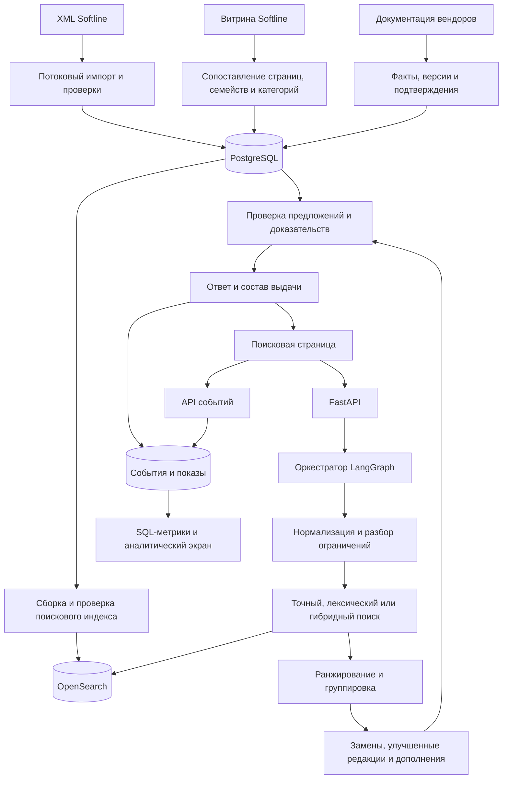

Для прототипа Softline я предлагаю **модульное Python-приложение с одним поисковым API, оркестратором на LangGraph, поисковым индексом OpenSearch и PostgreSQL для каталога, доказательств совместимости и аналитических событий**. Офлайн-процесс готовит версионированную выгрузку. Онлайн-процесс понимает запрос, выбирает способ поиска, проверяет конкретные предложения и возвращает покупателю карточки с объяснениями.

**Первый результат командной разработки — сквозной поиск на реальных данных.** Покупатель вводит запрос, получает целевую страницу и карточки, открывает одну из них, а команда видит, какие предложения были показаны и на какое нажали. На этом работающем сценарии можно независимо улучшать понимание запроса, ранжирование и рекомендации. Такой порядок снижает риск обнаружить несовместимость модулей накануне питча.

Ниже — проект архитектуры и план до **2 декабря 2026 года**. Стек, распределение ролей и пороги приёмки — мои проектные предложения. Основание для требований — бриф и Excel заказчика. Оба исследования использованы как источники инженерных решений. Работу выполнил в режиме чтения, результат целиком приведён в чате. [Бриф Softline](<C:/Users/RogZep/Desktop/Projects/ai_kuznica/Умный поиск на сайте/ИИкузница_—_Умный поиск на сайте.pdf>) · [Выборка запросов](<C:/Users/RogZep/Desktop/Projects/ai_kuznica/Умный поиск на сайте/Выборка поисковых запросов.xlsx>) · [Подборка материалов](<C:/Users/RogZep/Desktop/Projects/ai_kuznica/materials.md>) · [Добавленное исследование](<C:/Users/RogZep/Desktop/Projects/ai_kuznica/add_research.md>)

## 1. Какие свойства данных определяют архитектуру

| Наблюдение | Следствие для реализации |
|---|---|
| В XML **136 040 предложений**, 9 311 категорий и 1 232 вендора. Доступными помечены **44 601** предложение. У всех доступных предложений этого снимка цена положительная. У 80 269 недоступных цена равна нулю, ещё у 11 170 недоступных цена положительная | Наличие и цена — два независимых признака. Нулевую цену отображаем как неизвестную. Положительная цена сама по себе не подтверждает возможность покупки. |
| У 127 915 предложений заполнен `group_id`, но различных значений всего **4 413**. Ещё у **8 125** предложений группа отсутствует | Единица покупки — конкретное предложение. Единица группировки в выдаче — семейство, если связь установлена. Пустой `group_id` нельзя превращать в одну общую группу. |
| Excel содержит десять пар «запрос → целевой URL». Среди целей есть продукт, вендор и категория с фильтром. Ни один целевой адрес буквально не равен `offer.url` в XML | Нужны две сущности в ответе: **куда ведёт запрос** и **какие товары можно выбрать**. По `мтс` это витрина МТС Линк и предложения вендора. По `кибер бэкап` — витрина Киберпротекта с фильтром категории `1033` и соответствующие предложения. |
| Категория и название иногда расходятся. Например, предложение `535372` в категории «Rack-серверы» называется «Рабочая станция DEPO Race ST918» | Категория даёт сигнал для поиска. Тип товара проверяется дополнительно по названию и атрибутам. Это отдельный тест для сценария «сервер». |
| В выданных материалах есть примеры целевого первого результата. История показов, кликов, корзин и заказов команде пока не передана | Для первого прототипа рекомендации строятся на назначении и подтверждённой совместимости. События начинаем собирать с первой работающей версии. О росте продаж можно будет говорить после измерения на реальном трафике. |

Я бы **изменил ранее предложенную демонстрацию «сервер до 300 тысяч»**. Среди 22 проверенных электронных предложений, отобранных по категориям Rack-серверов, микросерверов или началу названия «Сервер», только два были доступны с положительной ценой до 300 000 ₽. Одно из них — упомянутая рабочая станция. Это хороший тест на корректный ответ при дефиците подходящих товаров. Для демонстрации четырёх уверенных попаданий лучше заранее подтвердить другой запрос полным прогоном. [Каталог Softline](<C:/Users/RogZep/Desktop/Projects/ai_kuznica/Умный поиск на сайте/Mindbox.yml.gz.xml>)

## 2. Архитектурный контур



Предлагаю три независимо запускаемые части из одного репозитория и одного образа приложения.

- **`api`** обслуживает поиск, интерфейс, приём событий и чтение аналитических агрегатов. Браузер обращается только к API.
- **`catalog-job`** импортирует XML, сопоставляет сущности, готовит факты и строит индекс. Запускается отдельно при новой выгрузке или смене модели. Внешние документы для демонстрационного набора загружаются заранее.
- **`eval-job`** прогоняет одну и ту же выборку через разные конфигурации поиска, сохраняет выдачи, метрики, ошибки и условия эксперимента. Его можно запустить локально, в CI и на машине демонстрации.

### Офлайн-оркестрация

Последовательность задач: **регистрация исходников → потоковый разбор XML → проверка данных → построение семейств и навигации → присоединение проверенных фактов → индексация → контрольные запросы → активация**.

Каждая сборка получает `bundle_id`. В её манифест входят контрольная сумма XML, версия преобразований, словаря, навигационных связей, доказательств, модели эмбеддингов и имя физического индекса. Новые таблицы и индекс заполняются под новым идентификатором. После проверок одна транзакция в PostgreSQL переключает указатель активной сборки. Поисковый запрос читает указатель один раз и использует его до конца. Так цена, наличие, векторные результаты и карточка относятся к одному снимку. При неудачной сборке покупатели продолжают пользоваться предыдущей.

Для этого объёма достаточно CLI с явными зависимостями шагов, журналом запусков и блокировкой одновременной активации. Полный пересчёт эмбеддингов нужен при смене модели или правил формирования текста. При обновлении только цены можно повторно использовать вектор с совпадающим хешем текста и ревизией модели.

### Онлайн-оркестрация

| Маршрут | Пример | Что делает система |
|---|---|---|
| Точный | Артикул, `КриптоПро CSP 5.0` | Проверяет точное совпадение, вендора, версию и редакцию. Если запрос относится к семейству, возвращает его страницу и варианты покупки. |
| Навигационный | `мтс`, `кибер бэкап` | Определяет вендора либо сочетание вендора и категории. Получает канонический URL и выбирает товары внутри установленной области. |
| Поиск по потребности | `российский антивирь для винды на 50 компов` | Нормализует жаргон, выделяет ОС, число устройств и требования к происхождению. Запускает лексический и смысловой поиск. Проверяет условия на уровне конкретной лицензии. |
| Альтернатива или дополнение | `чем заменить Windows Server`, `что докупить к Astra Linux` | Определяет исходный продукт и тип связи. Для замены проверяет требуемую функцию. Для дополнения проверяет назначение, редакции и источник совместимости. |
| Недостаточно данных | Недостаёт редакции либо найдено мало товаров | Один раз расширяет поиск по безопасным вариантам написания или семейству. Затем возвращает подтверждённые результаты, обозначенные альтернативы и при необходимости один уточняющий вопрос. |

**Оркестратор получает ограниченный набор действий.** В состоянии запроса хранятся `search_id`, `bundle_id`, интерпретация, обязательные ограничения, кандидаты, основания рекомендаций, число попыток и оставшееся время. Для MVP предлагаю максимум одно расширение и один вызов LLM для сложного разбора. Простые запросы проходят по детерминированному маршруту. При тайм-ауте модели доступны словарь, разбор чисел и поиск. В журнале фиксируются выбранный маршрут, причина и длительность узлов. [Условные маршруты и оркестрация в LangGraph](https://docs.langchain.com/oss/python/langgraph/workflows-agents)

## 3. Технологический стек

| Слой | Выбор для первой версии | Причина |
|---|---|---|
| Язык и окружение | Python 3.12, `uv`, `pyproject.toml`, `uv.lock` | Один воспроизводимый набор зависимостей для разработчиков, CI и контейнера. |
| API и контракты | FastAPI, Pydantic v2, OpenAPI, JSON Schema | Общие схемы для API, событий, инструментов агента, фикстур и интеграционных тестов. |
| Оркестрация запроса | LangGraph, узлы в виде обычных типизированных функций Python | Можно тестировать каждый узел отдельно, воспроизводить маршрут и ограничивать повторы. |
| Данные | PostgreSQL, SQLAlchemy, Alembic | Каталог, связи, доказательства, версии и события помещаются в одну реляционную модель. SQL подходит и для первых аналитических витрин. |
| Поиск | Один OpenSearch с BM25 и векторным полем. Объединение списков через RRF в приложении | Один движок для точных названий, текста, фильтров и смыслового поиска. Объединение в приложении позволяет видеть вклад каждого канала в экспериментах. [Поиск по нескольким полям](https://docs.opensearch.org/latest/query-dsl/full-text/multi-match/) · [Фильтрация векторного поиска](https://docs.opensearch.org/latest/vector-search/filter-search-knn/index/) |
| Модели | `multilingual-e5-small` как стартовый энкодер, `sentence-transformers`, RapidFuzz, словарь доменных синонимов. LLM подключается через адаптер структурированного вывода | Небольшую модель проще испытать на машине команды. Префиксы `query:` и `passage:`, нормализацию и ревизию весов фиксируем в манифесте. Реранкер добавляем после измерения прироста и задержки. [Карточка E5](https://huggingface.co/intfloat/multilingual-e5-small) |
| Интерфейс | Jinja2 и небольшой модуль JavaScript, аналитика на SQL и Plotly | Одна веб-служба. В браузере можно различить получение ответа, фактический показ карточки и клик. |
| Качество и доставка | pytest, Ruff, mypy для публичных интерфейсов, Playwright для сквозного сценария, Docker Compose, GitHub Actions | Локальная разработка и CI используют одинаковые сервисы. Сценарий браузера проверяет одновременно выдачу и события. |

**Выбор одного поискового движка здесь осознанный.** В материалах есть рабочая альтернатива с отдельным лексическим движком и Qdrant. До питча второй индекс увеличивает объём синхронизации, настройки и проверки отката. Один OpenSearch закрывает обе потребности. Контракт `retrieve` оставляет возможность заменить реализацию после сравнительного эксперимента.

Решение по поставщику LLM зависит от доступных команде GPU, сетевого доступа и разрешения на передачу запросов. Для разработки сразу нужны две реализации одного адаптера: реальная модель и детерминированная заглушка для CI. Демо должно запускаться с заранее загруженными весами и подготовленной базой доказательств.

## 4. Модель данных и логика выдачи

| Сущность | Что хранит | Правило |
|---|---|---|
| `Offer` | ID предложения, вендор, семейство, категории, цена, валюта, наличие, тип поставки, параметры лицензии, URL, версия выгрузки | Финальная проверка бюджета, количества устройств и наличия выполняется на одном `offer_id`. |
| `ProductFamily` | Вендор, идентификатор семейства, каноническое имя, варианты, при наличии URL страницы продукта | Исходный `group_id` — первый кандидат для группировки. Для позиции без надёжной группы используется отдельный стабильный ключ на основе `offer_id`. |
| `NavigationTarget` | Тип `product`, `vendor` или `filtered_category`, канонический URL, правила отбора предложений, основание сопоставления | Сохраняются значимые параметры URL, включая фильтр категории. Связь получаем из каталога и подтверждённых страниц витрины. |
| `ProductRelation` | Исходный и целевой продукт, `alternative`, `upgrade`, `complement`, `compatible`, `incompatible`, область действия | Функциональная замена, улучшенная редакция и совместимое дополнение имеют разные условия показа. |
| `Evidence` | URL источника, дата получения, короткий фрагмент, продукт и версия, подтверждаемое утверждение | Ссылка должна подтверждать именно то, что написано в карточке. При конфликте версий рекомендация уходит на проверку. |
| `SearchResponseManifest` | `response_id`, сборка, версия поиска, целевая страница, блоки, позиции, ID показанных кандидатов | Служит основанием для проверки кликов и воспроизведения выдачи. |

**Алгоритм ранжирования.** Сначала сохраняем исходную строку для обработки внутри запроса и строим нормализованный вариант. Токены версий, артикулов и числа устройств защищаем от агрессивного исправления. Поисковый документ включает название, вендора, путь категории, семейство, значимые параметры и описание. В лексическом поиске точное название, артикул и версия получают больший вес, чем случайное упоминание в описании.

Далее оба канала получают одинаковые обязательные фильтры и возвращают кандидатов с идентификаторами предложений. Стартовая настройка для испытания — до 100 кандидатов на канал. RRF объединяет списки по `offer_id`. После уточнения оценок группируем подходящие варианты по семейству, выбираем представителя и проверяем его в PostgreSQL. Это исключает ошибку, когда от одного варианта берут низкую цену, а от другого — право использования на 50 устройствах.

**Правило четырёх товаров нужно сделать наблюдаемым.** В ответе раздельно возвращаются `landing`, `matches`, `alternatives` и `addons`. В протоколе считаем число прямых совпадений, уникальных предложений и семейств. Заголовок категории и повтор одной карточки количество товаров не увеличивают. До ответа заказчика основной показатель — четыре релевантных прямых предложения, отдельно показываем покрытие при учёте альтернатив. Если после расширения достоверных позиций меньше, ответ получает `partial` и причину. Для приёмки это регистрируется как недобор. Такой порядок сохраняет и требование брифа, и смысл пользовательского ограничения.

**Допродажи.** Для первой версии достаточно таблицы проверяемых связей и нескольких семейств с хорошим покрытием. Например, в каталоге есть серверная лицензия КриптоПро CSP 5.0 КС3 для Astra Linux SE, `offer_id=458218`. Показ уместен, когда покупателю нужна криптографическая защита сервера. В карточке указываются функция, тип лицензии и основание совместимости. Для общего запроса `Astra Linux` эта позиция может появиться в блоке дополнений. [Карточка Softline](https://store.softline.ru/kripto-pro/-458218/) · [Документация производителя](https://cryptopro.ru/products/csp)

## 5. Контракты модулей, функций и API

**Первый совместный PR должен содержать исполнимые контракты и примеры.** После него разработчик интерфейса может работать на фикстурах, разработчик поиска — на эталонном каталоге, а аналитик — на примерах событий. Ниже предлагаемые публичные границы.

| Модуль | Основной контракт | Обязательство перед потребителем |
|---|---|---|
| `catalog` | `build_snapshot(source, config) → SnapshotManifest` | Повторный запуск на тех же входах даёт тот же логический набор данных. Неполная сборка не активируется. |
| `navigation` | `resolve_target(intent, bundle_id) → TargetMatch \| None` | Возвращает тип, URL, область отбора предложений и основание совпадения. Не подставляет целевой ответ по номеру строки Excel. |
| `understanding` | `parse_query(request, context) → SearchIntent` | Возвращает нормализацию, намерение, сущности, обязательные ограничения, предпочтения и неоднозначные поля. |
| `retrieval` | `retrieve(intent, bundle_id, channel, limit) → CandidateList` | Каждый кандидат содержит ID, канал и позицию. Пустой список и недоступность индекса различимы. |
| `ranking` | `rank(intent, candidates, policy) → RankedOffers` | При одинаковых входах и версии политики порядок воспроизводим. Правило разрешения равных оценок зафиксировано. |
| `recommendations` | `recommend(anchor, intent, bundle_id) → RelationCandidate[]` | Каждая рекомендация содержит тип связи, целевой ID и основания. Статус проверки совместимости передаётся явно. |
| `validation` | `validate(intent, selection, bundle_id) → ValidationReport` | Для каждой позиции возвращает `pass`, `fail` или `unknown` с кодом причины. `unknown` не удовлетворяет обязательному ограничению. |
| `orchestration` | `run_search(request, runtime) → SearchResponse` | Управляет маршрутом, дедлайном, повтором, частичной выдачей и версиями. Только этот модуль принимает решение о повторном проходе. |
| `analytics` | `record_events(batch, producer) → IngestReceipt` | Принимает версионированные события, повторная доставка не увеличивает показатели. Возвращает исход каждого события. |
| `evaluation` | `evaluate(run_spec, judgments) → EvaluationReport` | Сохраняет конфигурацию, результаты по запросам, агрегаты и список регрессий. |

### Внешние интерфейсы

- **`POST /v1/search`** принимает `query`, `session_id`, явно выбранные фильтры и при переформулировке `parent_search_id`. Возвращает `search_id`, `response_id`, `bundle_id`, `status`, `landing`, блоки карточек, краткую интерпретацию, причины недобора и возможное уточнение.
- **`POST /v1/events`** принимает пачку разрешённых клиентских событий. Сервер проверяет тип производителя, схему, принадлежность `response_id` и наличие карточки в заявленном блоке и позиции.
- **`GET /v1/suggest`** — бонусный интерфейс префиксных подсказок. У выбранной подсказки есть собственный ID и связь с последующим поиском.
- **`GET /health/live` и `GET /health/ready`** разделяют работоспособность процесса и готовность обслужить запрос на активной сборке.

В контракте фиксируются также валюта и тип денег (`Decimal` в домене, точное десятичное представление в API), часовой пояс событий UTC, семантика `null`, типы идентификаторов и ошибки. Некорректный ввод получает `422`, корректный запрос без совпадений — `200` с `empty`, недоступность обязательного хранилища — `503`. Отказ дополнительной модели отражается признаком упрощённого режима. Это важно для аналитики: технический отказ нельзя записывать как отсутствие спроса в каталоге.

## 6. События для аналитики пользовательских запросов

События стоит реализовать одновременно с первым поисковым экраном. Иначе уже при демонстрации будет трудно ответить, какие карточки увидел пользователь и какая версия ранжирования их сформировала.

| Событие | Производитель и момент записи | Для чего используется |
|---|---|---|
| `search_submitted` | API принял валидный поисковый запрос | Число поисков, тип запроса, начало сценария. |
| `search_completed` / `search_failed` | API завершил поиск либо зафиксировал технический отказ | Время ответа, маршрут, размер выдачи, `partial`, `empty`, причины ошибки. |
| `results_impression` | Браузер зафиксировал показ блока или карточек по согласованному правилу видимости | Знаменатель CTR. Ответ сервера сам по себе показом не считается. |
| `result_clicked` | Пользователь открыл карточку, страницу продукта, вендора или категории | Клики по позиции, типу результата и блоку выдачи. |
| `recommendation_clicked` | Пользователь открыл дополнение, замену или улучшенную редакцию | Интерес к типу рекомендации и к подтверждённой связи. Один клик учитывается один раз. |
| `query_reformulated` | Из текущего поиска отправлен уточнённый запрос с `parent_search_id` | Цепочки уточнений, запросы с трудным первым шагом. |
| `suggestion_selected` | Выбрана подсказка | Доля использованных подсказок и результат последующего поиска. |
| `add_to_cart` / `purchase_confirmed` | Будущая интеграция с корзиной и системой заказов | Конверсия и допродажи. До подключения магазина эти показатели имеют статус «нет данных». |

**Общие поля** — `event_id`, `event_type`, `schema_version`, `occurred_at`, `received_at`, `environment`, `traffic_type`, `session_id`, `search_id`, опциональные `parent_search_id` и `response_id`. Для показов и кликов добавляются `section`, `position`, `entity_type`, `entity_id`. Версии каталога, модели и поиска сервер восстанавливает по манифесту ответа. `traffic_type` различает реальные сессии, демонстрацию и автотесты.

**Доставка и качество.** Клиент создаёт `event_id` один раз и повторяет доставку с тем же ID. PostgreSQL обеспечивает уникальность. Сервер сохраняет состав выдачи и событие завершения в одной транзакции. Показ получает логический ключ ответа, блока и карточки, чтобы повторная отрисовка не увеличивала знаменатель. Для опоздавшего клика сохраняются время действия и время приёма. Повтор той же пачки должен дать прежние агрегаты. Если клиентская телеметрия временно недоступна, карточки продолжают открываться, а система считает потери и отказы доставки.

**Текст запроса.** Для аналитики по умолчанию достаточно очищенного представления, извлечённых признаков, типа намерения и причин неудачи. До долговременного хранения из свободного текста удаляются контакты, ключи и произвольные идентификаторы. Доступ к выборке обезличенных текстов для ручной разметки, срок хранения и возможность использования внешней LLM необходимо согласовать с владельцем данных.

**Первый аналитический экран** должен отвечать на четыре вопроса: что искали, где возникала пустая или неполная выдача, какие запросы переформулировали и какие рекомендации открывали. Из агрегата нужен переход к обезличенному примеру с версией индекса и причиной. Высокая доля пустых результатов — повод проверить каталог, словарь и ранжирование. Вывод «товара нет в ассортименте» требует отдельной проверки.

## 7. `AGENTS.md` и правила параллельной разработки

Предлагаемая структура будущего репозитория:

```text
AGENTS.md
CODEOWNERS
src/softsearch/
  contracts/        catalog/          navigation/
  understanding/    retrieval/        ranking/
  recommendations/  orchestration/    validation/
  api/              analytics/        evaluation/
contracts/
  openapi/          events/           examples/
docs/
  decisions/        methodology/      runbooks/
tests/
  unit/             contract/         integration/
  e2e/              fixtures/
infra/
.github/workflows/
```

**Корневой `AGENTS.md` — инструкция для следующего исполнителя, который откроет репозиторий без истории чата.** Его начальная редакция должна отвечать на следующие вопросы.

| Раздел `AGENTS.md` | Что в нём зафиксировать |
|---|---|
| Цель и источники истины | Ссылка на бриф, правила использования десяти целевых примеров, активные архитектурные решения и словарь сущностей. Определения товара, семейства, показа, клика, совместимости и частичного ответа. |
| Карта владения | Кто отвечает за каждый модуль, данные, схемы, миграции, оценку и релиз. Как связаться с владельцем границы, которую затрагивает задача. |
| Зависимости | UI вызывает публичный API. Оркестратор использует интерфейсы узлов. Поисковый адаптер не пишет события клика. Аналитика читает согласованную модель событий. |
| Работа над задачей | Прочитать контракт и фикстуру, указать область изменения, воспроизвести исходное поведение, внести правку, выполнить проверки и описать наблюдаемый результат. |
| Запуск и проверки | Точные команды для установки окружения, запуска малой фикстуры, импорта полного снимка, тестов модуля, сквозного поиска и оценки. В CI выполняются те же команды. |
| Изменение контрактов | Добавление необязательного поля сопровождается проверкой старого клиента. Удаление поля или изменение его смысла требует новой версии, миграции и переходного периода. |
| Работа с данными и моделями | Где брать исходники, как проверить хеш, как воспроизвести индекс, куда сохранять артефакты, как обращаться с данными сессий. Версии промптов и моделей входят в отчёт эксперимента. |
| Критерий завершения | Приведён вход, ожидаемый результат и запускаемая проверка. Изменение поиска содержит примеры улучшений и регрессий. Изменение события содержит пример полезной нагрузки и проверку метрики. |
| Передача работы | Краткая запись в PR: что изменилось, какие контракты затронуты, что проверено, что остаётся открытым, кто отвечает за следующий стык. |

**Контракт функции** должен описывать вход, выход, обязательные поля, инварианты, порядок результатов, ошибки, поведение при пустом вводе, тайм-ауте и повторе, побочные эффекты и версию данных. Для публичной границы нужны как минимум нормальный пример и пограничный случай. Источник HTTP-схем — Pydantic-модели с генерируемым OpenAPI. CI проверяет расхождение между текущей генерацией и зафиксированной версией контракта.

**Контракты методологий** столь же важны, как API. В `docs/methodology/` я бы предусмотрел четыре коротких документа: правила разметки релевантности, проверку товарных связей и источников, словарь аналитических событий и протокол поискового эксперимента. У каждого есть владелец, версия, примеры неоднозначных случаев и процедура изменения. Например, изменение определения «показ» требует версии методики CTR и явной отметки на графике.

**Организация работы людей и агентов.** Один человек отвечает за интеграцию и выпуск. У каждого публичного контракта есть владелец со стороны поставщика и проверяющий со стороны потребителя. Агент получает одну ограниченную задачу, список разрешённых модулей, входную фикстуру и критерий готовности. Изменения общего контракта, миграции или схемы события выпускаются отдельным небольшим PR. Пока он рассматривается, остальные исполнители используют его согласованные примеры. Это позволяет параллелить работу без одновременного редактирования центрального оркестратора несколькими агентами.

## 8. Метрики и методология экспериментов

| Метрика | Определение и применение |
|---|---|
| **Target Hit@1** | Число запросов из десяти, для которых первая целевая страница соответствует Excel. Показываем `x/10` и ошибки по строкам. Для категории учитываем фильтр, для продукта — утверждённую каноническую страницу или подтверждённый эквивалент. |
| **Покрытие четырьмя товарами** | Доля валидных запросов с четырьмя уникальными прямыми предложениями, прошедшими проверки. Отдельно — доля с четырьмя семействами и доля с учётом альтернатив. Всегда показываем знаменатель. |
| **Precision@4** | Количество вручную подтверждённых релевантных прямых карточек в первых четырёх позициях, делённое на четыре. Пропущенная позиция получает ноль. Считается на размеченной выборке. |
| **NDCG@10** | Качество порядка на выборке с градуированной разметкой первых позиций. Навигационная цель, прямая выдача и дополнения оцениваются по своим задачам. |
| **Соблюдение ограничений** | Доля выданных как подходящие предложений, для которых подтверждены все обязательные ограничения. Отдельные счётчики для цены, платформы, версии, количества лицензий. |
| **Качество дополнений** | Доля просмотренных экспертом рекомендаций с корректной ролью, подходящими версиями и подтверждающим источником. Дополнительно — доля запросов, для которых такое дополнение найдено. |
| **Надёжность** | p50/p95 времени по маршрутам, доля технических отказов, доля переходов в упрощённый режим, повторов и недобора. Для LLM — число вызовов и стоимость на запрос. |
| **Поведение** | Доля показанных выдач с кликом, клики по дополнениям среди показов дополнений, доля переформулированных запросов. Заказы и средний чек подключаются при наличии фактических событий магазина. |

**Протокол оценки.**

1. Зафиксировать исходные десять запросов как публичную приёмочную выборку. Они проверяют соответствие ожиданиям заказчика. Отдельно собрать набор для разработки и отложенный набор для итоговой оценки.
2. Включить в дополнительный набор точные названия, версии, жаргон, опечатки, раскладку, навигацию, оборудование, бюджет, состав лицензии, отсутствие товара и противоречивые ограничения. Практический ориентир до питча — **50–100 дополнительных запросов**, с указанием фактически размеченного числа.
3. Собрать кандидатов из нескольких алгоритмов, перемешать их для разметчиков. Отдельно оценивать прямое совпадение, допустимую замену, дополнение и нерелевантную позицию. Часть примеров размечают два человека, спорные случаи разбирает владелец методики. Непроверенная позиция сохраняет статус `unjudged`.
4. Разделить близкие переформулировки и варианты одного семейства так, чтобы они не давали утечку между настройкой и отложенной проверкой. Веса и словари замораживаются до финального прогона. Сохранить версии данных, меток, модели, кода и конфигурации.
5. Выполнить последовательное сравнение: **BM25 → векторы отдельно → BM25 + векторы с RRF → добавление разбора намерения → добавление реранкера**, если он уложился в бюджет. На каждом шаге показать изменения по запросам и задержке. Допродажи оценивать собственным набором пар «продукт — дополнение».
6. Для релиза предлагаю добиваться **10/10 на известных целях**, нуля вымышленных ID и нуля известных нарушений жёстких ограничений на приёмочных тестах. Для задержки стартовый инженерный ориентир — p95 до 2 секунд для обычного прогретого поиска и до 5 секунд для маршрута с моделью. Это цели команды; фактические показатели измеряются на обозначенной машине. Числа из иллюстративных дашбордов исследования не использовать как показатели Softline.

## 9. CI/CD и выпуск данных

| Когда | Что запускается | Критерий прохождения |
|---|---|---|
| Каждый PR | Установка по lockfile, Ruff, проверка типов публичных границ, unit- и contract-тесты, проверка OpenAPI и JSON Schema | Новые и прежние клиенты читают поддерживаемые форматы. Изменение контракта явно отражено в PR. |
| PR, затрагивающий поиск, данные или события | PostgreSQL и OpenSearch в CI, импорт небольшой фиксированной выборки, сквозной поиск, браузерный показ и клик, повтор события | Показанный ID существует, повтор не удваивает счётчик, частичный ответ и отказ зависимости различимы. |
| Слияние в `main` | Сборка контейнера с SHA коммита, публикация в реестр проекта, развёртывание на тестовом стенде, smoke-тест | Стенд сообщает версии кода и данных. Проверены запрос на продукт, запрос на вендора, недобор и получение событий. |
| Новый XML, словарь, модель или правила ранжирования | Отдельная задача собирает кандидатный индекс, проверяет целостность, полный набор целей и сравнение с активной версией | Команда видит отчёт о регрессиях до переключения активной сборки. Большой XML и веса не скачиваются в каждом PR. |
| Релиз на демонстрационный стенд | Продвижение уже проверенного образа и совместимого `bundle_id`, миграции, readiness, контрольные запросы | Версия воспроизводится по манифесту релиза. Данные событий сохраняются при замене контейнера. |
| Регрессия | Возврат к предыдущей совместимой паре «образ + сборка данных» и контрольный прогон | Восстановлены поиск, карточки и приём событий. Предыдущий индекс хранится до завершения периода отката. |

Для миграций БД использовать последовательность **добавить → перейти на новое поле → удалить после периода совместимости**. Для деплоя — одна операция на окружение одновременно, секреты в настройках окружения, доступ к стенду только у релизной задачи. Для запуска на ноутбуке подготовить тот же Compose-манифест, готовый индекс и проверку готовности сервисов. Образ фиксируется по digest, модель — по ревизии. [GitHub Actions Environments](https://docs.github.com/en/actions/reference/workflows-and-actions/deployments-and-environments) · [Запуск зависимых сервисов в Compose](https://docs.docker.com/compose/how-tos/startup-order/)

## 10. План реализации до 28 ноября, 10:00 МСК

**К вечеру 26 ноября должен работать сквозной поиск на реальном каталоге. К 18:00 27 ноября замораживаем функциональность, к 20:00 собираем и проверяем версию для показа. Утро 28 ноября оставляем на запуск, репетицию и резерв.** План рассчитан на четыре параллельные роли и не требует ночной разработки.

| Роль | Зона ответственности |
|---|---|
| **А — интеграция и выпуск** | `AGENTS.md`, общие контракты, CI/CD, стенд, сборка и откат. |
| **Б — каталог и поиск** | Импорт XML, семейства, целевые страницы, BM25, фильтры и векторный поиск. |
| **В — оркестрация и рекомендации** | Разбор запроса, выбор маршрута, ограничения, повторный поиск, проверенная допродажа. |
| **Г — интерфейс, события и оценка** | Поисковая страница, показы и клики, аналитическая сводка, прогоны и сценарий питча. |

Роли обозначают зоны владения. Агенты могут параллельно готовить фикстуры, адаптеры и тесты. За слияние изменений на каждой границе отвечает один назначенный человек.

### 26 ноября — собрать работающий поиск

| Время, МСК | Работа команды | Критерий готовности |
|---|---|---|
| **11:30–13:00** | **А** фиксирует в `AGENTS.md` владельцев, команды запуска и порядок изменения контрактов. Команда согласует `SearchRequest`, `SearchResponse`, `SearchIntent`, `AnalyticsEvent` и три примера ответа: продукт, витрина вендора, недобор. **Б** начинает потоковый импорт XML. **В** описывает переходы оркестратора. **Г** поднимает интерфейс на согласованных примерах. | Один и тот же пример ответа проходит валидацию API и отображается в интерфейсе. У каждого исполнителя есть своя задача и проверяемый результат. |
| **13:00–16:00** | **А** поднимает PostgreSQL и OpenSearch через Compose, запускает CI. **Б** загружает каталог, строит лексический индекс и реализует получение реальной карточки по `offer_id`. **В** подключает маршруты точного и навигационного поиска. **Г** связывает форму с API и реализует регистрацию поискового запроса и клика. | Из браузера можно ввести запрос, получить реальное предложение из XML и открыть его карточку. `search_id` связывает запрос и действие пользователя. |
| **16:00–19:00** | **Б** добавляет группировку, доступность и сопоставление целевых страниц. **В** подключает нормализацию, проверку ограничений и ответ `partial`. **Г** различает ответ сервера и показ карточек в браузере, запускает все десять запросов Excel. **А** разворачивает сборку на общем стенде. | Команда видит первый **Hit@1 в формате `x/10`**, фактическое число карточек и причины ошибок по каждому запросу. На стенде воспроизводятся поиск продукта, переход на витрину МТС Линк и случай недобора. |
| **19:00–20:00** | Общий интеграционный прогон. **А** сохраняет рабочую версию и инструкцию запуска. **Б** на машине демонстрации измеряет скорость векторизации на части каталога, оценивает время полного расчёта и при приемлемом прогнозе запускает фоновую сборку. **В** подбирает товарную пару и источник для допродажи. **Г** фиксирует ошибки по приоритету. | Есть **первая резервная версия** с поиском на полном каталоге. Утром работу можно продолжить даже при сбое фоновой векторизации. |

### 27 ноября — проверить ценность, измерить результат и выпустить версию

| Время, МСК | Работа команды | Критерий готовности |
|---|---|---|
| **09:00–10:30** | **Б** проверяет индекс и устраняет наиболее частую причину ошибок первого результата. **В** реализует одну допродажу с проверкой версии и источника, например серверную лицензию КриптоПро CSP для Astra Linux SE. **Г** готовит компактную дополнительную выборку из **12–20 запросов** на жаргон, опечатки, версии, оборудование, навигацию и дефицит товаров. **А** проверяет развёртывание из чистого окружения. | Допродажа ведёт на реальную карточку и содержит основание рекомендации. Дополнительная выборка зафиксирована до итоговой настройки. |
| **10:30 — Q&A** | Один представитель команды уточняет, что считается четырьмя товарами, засчитываются ли альтернативы и как оценивать навигационные запросы. Остальные продолжают работу. Ответы фиксируются в решении проекта и в соответствующих тестах. | Спорные правила получили формулировку заказчика либо остались явно помеченными рабочими допущениями. |
| **11:00–14:00** | **Б и В** сравнивают BM25 и гибридный поиск на одинаковых запросах, проверяют сохранение версий, тип товара и обязательные фильтры. **Г** проверяет цепочку «поиск → показ → клик», повторную доставку события и раздельный учёт тестового трафика. **А** включает сквозной тест в CI. | Есть таблица сравнения с примерами улучшений и регрессий. Один клик после повторной доставки учитывается один раз. **В 14:00 выбираем конфигурацию для релиза** по качеству, задержке и готовности индекса. |
| **14:00–16:30** | Команда доводит три сценария: **`мтс`** — правильная витрина и товары вендора; **`астра линукс`** — нормализация, основной продукт и подтверждённое дополнение; **`сервер до 300 тысяч`** — проверка типа, бюджета и корректного недобора. **Г** выводит простую сводку по поискам, показам, кликам и неполным ответам. | Каждый сценарий проходит через обычный интерфейс. Для показа четырёх прямых предложений выбран запрос, на котором команда проверила четыре реальные карточки. |
| **16:30–18:00** | Итоговый прогон десяти официальных и дополнительных запросов. Два участника проверяют спорные карточки. Команда фиксирует Hit@1, покрытие четырьмя товарами, наблюдаемую задержку, ошибки и ограничения. **А** проверяет поведение при отказе модели и возврат к рабочей сборке. | Готов отчёт с фактическими числами и размером выборки. **В 18:00 — заморозка функций.** |
| **18:00–20:00** | **А** выпускает зафиксированную пару «образ приложения + версия данных». Другой участник запускает её по инструкции. **Г** проводит репетицию, сохраняет короткую резервную запись и результаты прогонов. Исправляются только дефекты, срывающие показ, нарушающие ограничения покупателя или искажающие метрики. | **К 20:00 готов комплект для питча**: основной стенд, проверенный локальный запуск, сценарий показа, отчёт и резервная запись. |

### 28 ноября — финальная проверка

| Время, МСК | Действие | Результат |
|---|---|---|
| **08:00–08:30** | Запуск релизной версии на машине показа. Проверка трёх сценариев, источника рекомендации и записи тестового клика. | Подтверждены работоспособность и версии приложения, каталога и индекса. |
| **08:30–09:00** | Полная репетиция в порядке питча. Один участник показывает путь покупателя, второй объясняет маршрутизацию, третий — метрики и события. | Демонстрация укладывается в отведённое время. |
| **09:00–09:30** | Резерв на восстановление стенда или переключение на проверенный локальный запуск. | К **09:30** выбран и открыт окончательный вариант показа. |
| **09:30–10:00** | Организационный запас на подключение, открытие материалов и начало выступления. | **К 10:00 команда готова к питчу.** |

**Приоритет при нехватке времени.** Сохраняем поиск на полном XML, оркестрацию, проверку ограничений, одну доказуемую допродажу, события показа и клика, прогон десяти официальных запросов и воспроизводимый релиз. Если гибридный поиск к **14:00 27 ноября** не прошёл проверку, для питча фиксируем рабочую лексическую конфигурацию с нормализацией и маршрутизацией, а результаты векторного эксперимента показываем отдельно. Реранкер, автодополнение, сравнение цен конкурентов, обучение моделей и расширенный дашборд переносятся за дедлайн.

**Критический путь** — контракты → импорт → связь целевых страниц с предложениями → сквозной baseline → проверка четырёх карточек → измерение и релиз. Если команда отстаёт, первыми сокращаются реранкер, подсказки, сравнение цен конкурентов и оформление дашборда. Сохраняются рабочая оркестрация, подтверждённая допродажа, события, проверка выдачи и воспроизводимый выпуск.

## 11. Подводные камни и решения, которые нельзя оставить на последний день

| Риск | Как обнаружить | Что делать |
|---|---|---|
| Поиск выучил десять ответов Excel | Малое изменение формулировки ломает выдачу | Проверять переформулировки и другие семейства. Документировать основание каждого алиаса. Тестировать навигацию отдельно от поиска предложений. |
| Четыре карточки — почти одинаковые лицензии | У первых четырёх один `group_id`, различается только срок | Показывать варианты внутри карточки. Отдельно считать SKU и семейства. Если пользователь явно ищет варианты лицензирования, сохранять различия в ответе. |
| Бюджет «собран» из разных вариантов | Цена относится к одной лицензии, лимит устройств — к другой | Проверять цену, количество, срок и тип клиента на одном предложении. Неизвестную метрику лицензирования направлять в уточнение. |
| Смысловой поиск теряет версию или подменяет оборудование программой | `CSP 5.0` выводит другую версию, `сервер` — серверное ПО | Сохранять значимые токены, учитывать намерение и тип, тестировать пары противоположных запросов и реальные противоречия каталога. |
| Генератор объясняет неподтверждённую совместимость | ID существует, но источник говорит о другой редакции | Проверять область действия доказательства. Карточка строится из БД, объяснение — из проверенных полей. Вендорский текст поступает как данные и не управляет инструментами агента. |
| ML-компонент слишком медленный или недоступен | Запросы простого маршрута начинают зависеть от модели | Отдельный дедлайн по маршрутам, предварительное вычисление векторов, ограничение кандидатов, лексический резерв. Измерить на машине питча до подключения реранкера. |
| Аналитика показывает ложный успех | Ответы API считаются показами, автотесты попали в реальные сессии, повторный клик удвоил метрику | Разделять производителя и тип трафика, валидировать позицию по манифесту, проверять повторы событий и определения знаменателей. |
| Новая версия индекса несовместима с приложением | Меняется размерность вектора, формат поля или схема ответа | Манифест совместимости, проверка до активации, физические версии индексов и отрепетированный откат. |
| Несколько агентов расходятся в предположениях | У каждого модуля собственное определение `product_id`, успешного поиска или `null` | Общий словарь, типизированные контракты, примеры и проверка поставщиком и потребителем. Любое изменение определения отражается одновременно в тестах и методике. |

**На встречу с заказчиком я бы вынес три решения с наибольшим влиянием на проект.** Первое — что засчитывается в четыре товара при разных лицензиях, отсутствии наличия или необходимости показать замену. Второе — какую страницу и порядок считать корректными для навигационных запросов и есть ли дополнительная закрытая разметка. Третье — какие данные и вендорские источники разрешено использовать для рекомендаций и измерения поведения. До получения ответов архитектура уже позволяет двигаться: она сохраняет отдельные типы результатов, версии данных и доказательства, поэтому уточнение бизнес-правила потребует изменения политики выдачи, а не перестройки всего приложения.